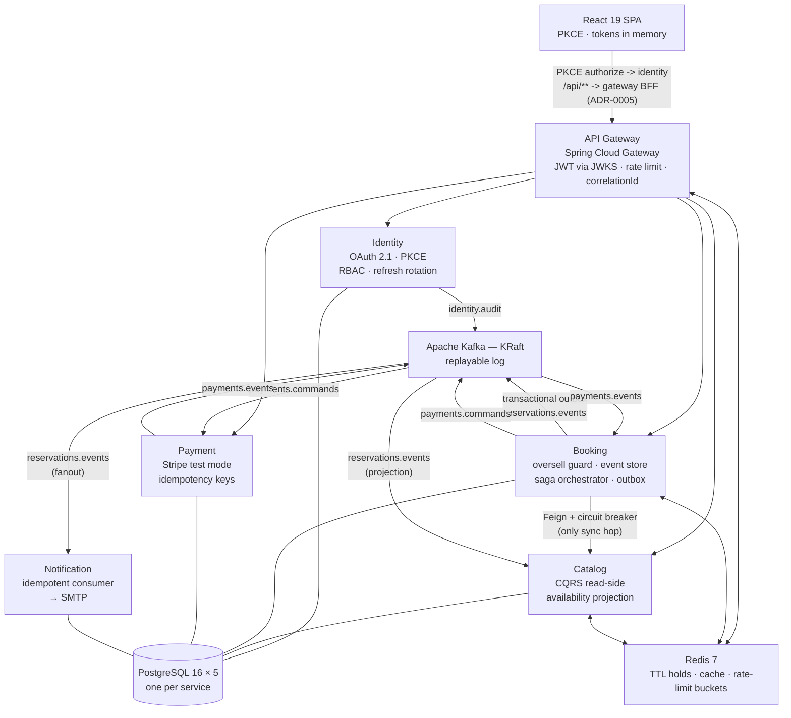

# STAMPEDE

**High-concurrency event ticketing that proves zero oversells under 1,000-VU flash-sale load.**

[](https://github.com/stampede-io/STAM-catalog/actions/workflows/ci.yml?query=branch%3Amain)
[](https://github.com/stampede-io/STAM-booking/actions/workflows/ci.yml?query=branch%3Amain)
[](https://github.com/stampede-io/STAM-payment/actions/workflows/ci.yml?query=branch%3Amain)
[](https://github.com/stampede-io/STAM-identity/actions/workflows/ci.yml?query=branch%3Amain)
[](https://github.com/stampede-io/STAM-gateway/actions/workflows/ci.yml?query=branch%3Amain)
[](https://github.com/stampede-io/STAM-frontend/actions/workflows/ci.yml?query=branch%3Amain)
[](https://github.com/stampede-io/STAM-platform/actions/workflows/nightly.yml)
[](https://github.com/stampede-io/STAM-platform/releases/tag/v0.2.0)

> **Nightly E2E is currently red** — two known workflow bugs (compose build-context path and a missing dev server in CI), not product regressions. Tracked for Sprint 3.
>
> **Milestone 2 demo video:** *(link goes here after recording)*
>
> **Try it now** — no registration needed: `user@demo.local` / `Demo2026!` (or `organizer@demo.local` / `Demo2026!` for the organizer role). Demo data is synthetic, no real PII, reset nightly at 03:00 UTC. *(Live demo URL and exact availability hours go here once STAM-50's VM is provisioned — off-hours, the 3-min demo video above covers the same flow.)*

## The problem

Ticket drops break systems. When a single "50,000 seats, on sale in 10 seconds" event lands, the two things everybody remembers are the ones you can never take back: the same seat sold twice, and the payment charged but ticket never issued. STAMPEDE is a portfolio-grade study of the specific patterns that keep those two failures from happening — orchestrated sagas, event sourcing, transactional outbox, partial-unique indexes as an oversell guard of last resort — under real load.

## Milestone 2 numbers

Secured flash-sale: 1,000 VUs over 100 s, single show, 100-seat pool, 200 pre-authenticated users, full **hold → pay → confirm** flow routed **through the gateway** with per-request JWT validation and Redis rate limiting.

| Metric                       | Threshold | M1 (direct) | M2 (through gateway) |
|------------------------------|-----------|-------------|----------------------|
| VUs (peak)                   | ≥ 1,000   | 1,000       | **1,000**            |
| Total HTTP requests          | —         | 424,726     | 101,890              |
| Reservations confirmed       | —         | 100 / 100   | **100 / 100**        |
| **Oversells (DB invariant)** | **0**     | **0** ✓     | **0** ✓              |
| `http_req_failed`            | < 1 %     | 64 %        | **0.00 %** ✓         |
| `http_req_duration` p99      | < 300 ms  | 716 ms      | 5.29 s ✗             |
| Saga convergence p99         | —         | —           | 1.35 s               |

**100 seats offered, 100 holds granted, 100 reservations confirmed, out of 100,356 concurrent attempts.** Every losing request got a clean 409.

The p99 gate is met up to ~300 VUs and misses beyond it. That is single-node saturation of the one gateway container on laptop hardware — throughput halves between 400 and 500 VUs while `http_req_failed` stays at 0.00 %, the signature of a queue, not an error. The gateway is stateless (rate-limit state lives in Redis), so Sprint 3's Kubernetes work scales it horizontally. **The oversell invariant held in all eight runs, at every VU level tested.**

Full report with knee-point sweep and bottleneck analysis: [`load-tests/results/flash-sale-secured-20260822-m2.md`](load-tests/results/flash-sale-secured-20260822-m2.md). M1 baseline: [`flash-sale-20260720-5690039.md`](load-tests/results/flash-sale-20260720-5690039.md).

## Architecture



The gateway → service edges (`GW --> ID/CAT/BK/PAY`) are HTTP routing. Between the business services, every edge is Kafka — except **booking → catalog**, a synchronous OpenFeign call for seat validation behind a Resilience4j circuit breaker so a catalog outage degrades booking rather than taking it down (`CircuitBreakerIT`).

> **The SPA → gateway edge is proven (STAM-440).** A Playwright spec with no `page.route()` mocks drives the real SPA through the real gateway — PKCE login against identity's own form, a seat map from catalog, a hold through booking. The gateway's BFF token handler (ADR-0005) keeps the refresh token in an httpOnly cookie; the SPA holds only the access token. The frontend runs as its own service in `docker-compose.yml`.

**Key invariants:**

- **Oversell guard of last resort:** a partial unique index on `reservation_seats (show_id, seat_id) WHERE status IN ('HELD','CONFIRMED')` — the database itself rejects a second live hold for the same seat. The insert *failing* is the mechanism; it surfaces as HTTP 409.
- **Saga crash recovery:** every saga instance is a durable row in `saga_instances` carrying `state`, `step`, and `updated_at`. A periodic recovery sweep re-drives any saga stuck past its deadline, so a `kill -9` mid-flow converges once the process comes back (`SagaRecoveryIT`).
- **Transactional outbox:** service state and the "please publish this Kafka event" row are written in the same DB transaction; a separate publisher polls the outbox and marks rows sent. Nothing is lost if the process dies between commit and publish — this gives **at-least-once** delivery.
- **Idempotent consumers:** at-least-once plus `processed_events` (catalog, notification) and `idempotency_keys` (payment) de-duplicates redelivered events, so the read-model projection and payment state converge exactly once. The email side is best-effort de-dup, not transactional — a crash between SMTP send and the `processed_events` write can still double-send (fine for Mailhog; a real relay would need a claimed/pending state).

## Quickstart

```bash
git clone https://github.com/stampede-io/STAM-platform
cd STAM-platform && bash scripts/clone-all.sh
cd compose-dev
cp .env.example .env          # if not already present
docker compose up -d --wait
```

Front door is the **gateway on `:8085`**. Services are also exposed directly for debugging:

```bash
curl http://localhost:8085/actuator/health   # gateway  (use this for real traffic)
curl http://localhost:8084/actuator/health   # identity
curl http://localhost:8081/actuator/health   # catalog
curl http://localhost:8082/actuator/health   # booking
curl http://localhost:8083/actuator/health   # payment
curl http://localhost:8086/actuator/health   # notification
```

Kafka UI: `http://localhost:8080` · Mailhog inbox: `http://localhost:8025`

## Contributing

Working on the Kubernetes track (`platform/`, Sprint 3)? You'll need
`kubeseal` to add or change any secret the cluster uses — plaintext
credentials never go into git here, only `SealedSecret` ciphertext.
Install/usage instructions, including which protocol version to match
to the controller: [`platform/sealed-secrets/README.md`](platform/sealed-secrets/README.md).
Rotating the controller's own key is covered separately in
[`docs/runbook.md`](docs/runbook.md#sealed-secrets-key-rotation-stam-57).

## Try it

Hold a seat, pay, confirm. These hit services directly, which skips auth — going through the gateway on `:8085` requires a bearer token from the PKCE flow.

```bash
# 1. list shows
curl http://localhost:8081/api/v1/shows | jq

# 2. list seats for a show
SHOW_ID=<uuid-from-above>
curl "http://localhost:8081/api/v1/shows/$SHOW_ID/seats" | jq

# 3. hold
SEAT_ID=<uuid-from-above>
curl -X POST http://localhost:8082/api/v1/reservations \
  -H "Content-Type: application/json" \
  -H "Idempotency-Key: $(uuidgen)" \
  -d "{\"showId\":\"$SHOW_ID\",\"userId\":\"$(uuidgen)\",\"seatIds\":[\"$SEAT_ID\"]}"

# 4. submit payment (starts saga)
RES_ID=<reservationId from previous response>
curl -X POST http://localhost:8082/api/v1/reservations/$RES_ID/submit-payment

# 5. poll for CONFIRMED
curl http://localhost:8082/api/v1/reservations/$RES_ID | jq

# 6. confirmation email lands in Mailhog
open http://localhost:8025
```

Force a compensation path by setting `PAYMENT_FAILURE_RATE=1.0` in `.env` and restarting payment — the saga will refund and release the seats instead of confirming.

## Demo mode (STAM-60)

The public demo deployment runs with `demoMode: true`
(`platform/charts/stampede/values-demo.yaml`), which does two things:

- Identity's `/login` page shows the demo credentials
  (`user@demo.local` / `Demo2026!`, `organizer@demo.local` /
  `Demo2026!`) instead of a blank login form.
- A CronJob resets the data nightly at **03:00 UTC**: it truncates
  every table in all five databases (schema untouched —
  `flyway_schema_history` is explicitly excluded) and restarts
  catalog/booking/identity, whose existing seed-on-boot logic
  repopulates fresh demo data as part of coming back up.

**Demo data is synthetic. No real PII. Reset nightly at 03:00 UTC.**

This is deliberately *not* the default (`demoMode: false` in
`values.yaml`) — it's a separate values file layered on only for the
public-facing deployment, the same pattern `values-staging.yaml` and
`values-prod.yaml` already use.

## Promotion workflow (STAM-62)

Deployment is git-driven end to end (ArgoCD, STAM-61) — the only thing
that differs between staging and prod is who commits the change.

**Staging — automated, one bump per service.** Every merge to a
service's own `main` runs that service's CI (the shared
`service-ci.yml`), which, after pushing the image to GHCR, opens a PR
*against this repo* updating only that service's `image.tag` in
`values-staging.yaml`. Merging that PR is the only human action —
ArgoCD's `stampede-staging` Application (`syncPolicy.automated`) picks
it up within ~3 minutes on its own. The other five services' tags are
untouched by that PR; six services merging independently never queue
behind each other.

Note this targets `values-staging.yaml` in *this* repo, not a
per-service file in `STAM-gitops` — that's what `stampede-staging`'s
Application actually reads (STAM-61's app-of-apps points at
`platform/charts/stampede -f values-staging.yaml`), so this is where a
bump has to land to mean anything. Same per-environment-not-per-service
adaptation STAM-61 already documented, applied consistently here.

**Prod — always a human PR, never automated.** Promoting a tag that's
been verified in staging means a person opens a PR here by hand
(`.github/PULL_REQUEST_TEMPLATE/prod-promotion.md`) copying that
`image.tag` into `values-prod.yaml` — a real released version, never a
bare commit SHA (CLAUDE.md §10's tagging rule, enforced by AC8's
version-drift gate at publish time). Merging it still doesn't deploy
anything: `stampede-prod` has no `syncPolicy.automated`, so it shows
`OutOfSync` until that same person runs `argocd app sync stampede-prod`
or clicks Sync in the UI. Two separate, deliberate actions — not one.

**The one piece this repo can't set up by itself:** each of the 6
service repos' CI needs a fine-grained GitHub PAT, scoped to this repo
only (`contents: write`, `pull-requests: write`, no broader access),
stored as that repo's own `GITOPS_PAT` secret — never a shared token in
one central place (AC5). Creating that PAT is a GitHub account action;
it has to be done by hand, once per service repo, by whoever
administers the `stampede-io` org.

See `docs/gitops.md` (STAM-gitops) for how a merge turns into a running
pod end to end.

## Load testing

```bash
# unsecured baseline (M1 shape — straight to booking)
bash load-tests/k6/run-flash-sale.sh

# secured (M2 shape — through the gateway with real JWTs)
bash load-tests/k6/run-flash-sale-secured.sh

# knee-point sweep at a fixed VU level
CONSTANT_VUS=300 CONSTANT_DURATION=20s bash load-tests/k6/run-flash-sale-secured.sh
```

Each runner discovers a seed show, resolves its seat IDs, invokes k6, writes both a `--summary-export` JSON and a stdout capture to `load-tests/results/flash-sale-<date>-<sha>.{json,txt}`, and then runs the DB-level oversell check as a hard `PASS/FAIL` gate.

Contention-only test (hold path, no payment): [`load-tests/k6/contention.js`](load-tests/k6/contention.js).
Rate-limit burst test: [`load-tests/rate-limit-burst.js`](load-tests/rate-limit-burst.js).

## Architecture decisions

| ADR   | Decision | Status |
|-------|----------|--------|
| [0001](docs/adr/0001-microservices-over-modular-monolith.md) | Microservices over modular monolith | Accepted |
| [0002](docs/adr/0002-orchestrated-saga-over-choreography.md) | Orchestrated saga (state machine in booking) over choreography | Accepted |
| [0003](docs/adr/0003-kafka-over-rabbitmq-and-sqs.md)         | Kafka as the event backbone (replayable log, per-partition ordering) | Accepted |
| [0004](docs/adr/0004-k8s-dns-over-eureka.md)                 | K8s DNS instead of Eureka | Accepted |
| [0005](docs/adr/0005-bff-token-handler-in-gateway.md)        | BFF token handler in the gateway | Accepted |
| [0006](docs/adr/0006-single-postgres-five-databases.md)      | One Postgres instance, five databases (cluster only) | Accepted |
| [0007](docs/adr/0007-strimzi-single-broker-kraft.md)         | Strimzi, single broker, KRaft | Accepted |
| [0008](docs/adr/0008-aws-ec2-for-the-demo-cluster.md)        | AWS EC2 + k3s for the demo cluster, replacing Azure | Accepted |

**STAM-56 evidence (the seven Eureka/Config Server deletion PRs behind ADR-0004):**
[STAM-gateway#13](https://github.com/stampede-io/STAM-gateway/pull/13) ·
[STAM-identity#13](https://github.com/stampede-io/STAM-identity/pull/13) ·
[STAM-catalog#25](https://github.com/stampede-io/STAM-catalog/pull/25) ·
[STAM-booking#32](https://github.com/stampede-io/STAM-booking/pull/32) ·
[STAM-payment#15](https://github.com/stampede-io/STAM-payment/pull/15) ·
[STAM-notification#9](https://github.com/stampede-io/STAM-notification/pull/9) ·
[STAM-platform#27](https://github.com/stampede-io/STAM-platform/pull/27)

## Repository layout (polyrepo)

Each service is its own git repo under the [`stampede-io`](https://github.com/stampede-io) org. This one, `STAM-platform`, is the shared-infra repo.

| Repo | Role |
|------|------|
| [STAM-gateway](https://github.com/stampede-io/STAM-gateway) | Spring Cloud Gateway — JWT validation, Redis rate limiting, correlation IDs |
| [STAM-identity](https://github.com/stampede-io/STAM-identity) | OAuth 2.1 Authorization Server — PKCE, RBAC, rotating refresh tokens |
| [STAM-catalog](https://github.com/stampede-io/STAM-catalog) | CQRS read-side — venue/event/show/seat CRUD, availability projection |
| [STAM-booking](https://github.com/stampede-io/STAM-booking) | Event-sourced reservation ledger + saga orchestrator |
| [STAM-payment](https://github.com/stampede-io/STAM-payment) | Stripe test-mode payment service, idempotency keys, saga command consumer |
| [STAM-notification](https://github.com/stampede-io/STAM-notification) | Idempotent Kafka consumer for booking emails |
| [STAM-frontend](https://github.com/stampede-io/STAM-frontend) | React + Vite + TS SPA — seat map, checkout, PKCE auth |
| **STAM-platform** *(this repo)* | Compose dev env, config repo, ADRs, load tests, Helm/Terraform (Sprint 3), nightly e2e |
| [STAM-gitops](https://github.com/stampede-io/STAM-gitops) | ArgoCD source of truth — app-of-apps, staging/prod manifests (Sprint 3) |

## Infrastructure (Sprint 3)

### Local kind cluster

`platform/kind/` + each service's own `k8s-local/` manifests — see
[`platform/docs/k8s-local.md`](platform/docs/k8s-local.md). Zero cost,
zero cloud dependency, the default day-to-day target while learning
Kubernetes fundamentals.

### AWS EC2 + k3s (`platform/terraform/`)

Provisions a single-node k3s cluster on one EC2 instance for the demo
([ADR-0008](docs/adr/0008-aws-ec2-for-the-demo-cluster.md)). **This costs
real money the moment `terraform apply` runs.** It is meant to live for
one demo week at most. The default `m6i.2xlarge` (8 vCPU / 32 GB, full CPU
with no burst credits) in `ap-south-1` is about $0.40/hour; with the 64 GB
gp3 disk and the Elastic IP, a full week is about $70 of the $200 of
credits. Do the Dev→main release and rehearse on kind *before* applying,
so the week isn't spent waiting on CI, and destroy it at the end.

A Budget alarm (`budget_limit_usd`, default $100) emails `budget_email` at
50%, 80% and 100%. It ignores credits on purpose: counting them, the
"actual cost" stays near $0 until the credits are gone.

**State** is remote, in S3, with the S3 backend's native lockfile
(Terraform >= 1.10, no DynamoDB). One-time setup, after `aws configure`:

```bash
cd platform/terraform/bootstrap
REGION=ap-south-1 ./bootstrap-state.sh   # prints the terraform init flags
```

The state bucket can't live in the state it holds, so it's a plain
`aws` script, and `terraform destroy` leaves it alone.

```bash
cd platform/terraform
cp terraform.tfvars.example terraform.tfvars   # operator_ip, budget_email
terraform init -backend-config=...             # the three flags printed above
terraform apply                                # real spend starts here
terraform output                               # public_ip, ssh_command, backup_bucket, region
```

Then point DuckDNS at `public_ip` and follow
[`platform/ingress/README.md`](platform/ingress/README.md) for TLS. The
ingress serves the API only. The SPA is not deployed on the cluster yet;
wherever it runs, the browser must reach the API on the SPA's own origin
(a proxy or rewrite), or the BFF refresh cookie becomes third-party.

### Resource teardown discipline

Between sessions, stop the instance (the Elastic IP keeps the DuckDNS
record valid; you still pay for the disk and the IP):

```bash
aws ec2 stop-instances --instance-ids $(aws ec2 describe-instances   --filters Name=tag:Name,Values=stampede-k3s --query 'Reservations[].Instances[].InstanceId' --output text)
```

After the demo:

```bash
terraform destroy
aws resourcegroupstaggingapi get-resources --tag-filters Key=Project,Values=stampede   # should be empty
```

## Observability

Every log line is structured JSON. A `correlationId` MDC field, minted at the gateway, threads a single business transaction through every service and rides on `EventEnvelope.correlationId` through Kafka:

```bash
docker compose logs -f booking payment | jq -r 'select(.correlationId) | "\(.service)\t\(.correlationId)\t\(.message)"'
```

The same `correlationId` appears in booking log lines (saga started, `PaymentAuthorized` received, reservation confirmed) and in payment log lines (`AuthorizePayment` received, outcome emitted) for the same transaction.

## Status

**Milestone 2 (tag: `v0.2.0`) — complete.** Secured stack: OAuth 2.1 identity service, API gateway with JWT validation and Redis rate limiting, Stripe test-mode payments, notification emails, React SPA with a PKCE checkout flow. Built on the zero-oversell core from `v0.1.0`. All backend Testcontainers integration tests green across seven repos.

Test coverage at M2 was two separate layers: 38 Playwright E2E specs exercise the SPA against **mocked** API responses, and a secured k6 flash-sale drives the **gateway and backend** with real JWTs (0 oversells at 1,000 VUs). The real browser-through-gateway journey was added later (STAM-440): `npm run test:e2e:real` in `STAM-frontend` drives register → PKCE login → seat map → hold with no mocks.

**Milestone 1 (tag: `v0.1.0`) — complete.** Compose-based deploy, catalog + booking + payment + Kafka + Redis + Postgres. Full hold → pay → confirm saga with compensation and crash recovery.

**Milestone 3 (tag: `v0.3.0`, 2026-10-14):** Kubernetes-native deployment — raw manifests on kind, Terraform for a k3s node (Azure at the time, AWS since STAM-457), Helm umbrella chart, shared Postgres and Redis on cluster, Sealed Secrets, ArgoCD app-of-apps. Eureka and Config Server are deleted (STAM-56), fulfilling ADR-0004. Some Sprint 3 stories still need the live k3s cluster to close; see below.

## Known limitations

From the STAM-71 hardening audit, [`docs/hardening-audit.md`](docs/hardening-audit.md), which links each item to its evidence. These are real gaps, not planned features.

**Open defects**
- **Identity's signing key isn't set on the cluster yet** ([STAM-454](https://puliththewmika-dev.atlassian.net/browse/STAM-454)). Identity now loads `IDENTITY_RSA_PRIVATE_KEY` and derives the `kid` from the key, so a restart no longer makes validators reject new tokens. Until the key is sealed into `identity-db-secret` ([how](platform/sealed-secrets/README.md#identitys-jwt-signing-key-stam-454)), though, each identity pod start still invalidates tokens issued before it, and two replicas would sign with different keys.
- **Only catalog and booking dead-letter.** Payment, identity and notification have no DLQ recoverer; `payments.commands.dlq` and `identity.audit.dlq` are never written. Payment and identity send to Kafka directly with no outbox (booking is the only outbox). Since STAM-452 a non-JSON record no longer stalls any consumer, but in those three services it is logged and skipped rather than kept.

**Not yet proven on the real cluster.** These need the k3s node on AWS to be up:
- `kubectl auth can-i` for workload ServiceAccounts, and reading the applied security group back from AWS. Its rules and the non-root `securityContext` are proven from config and on kind only.
- Canary auto-rollback and blue-green promotion were drilled on kind against stand-in pods, not the real services, and neither is screen-recorded.
- A `git revert` rollback through ArgoCD has never been timed end to end.
- The Postgres restore drill ran on kind; the S3 download step has never run, because no backup has landed in S3 yet.

**Not built**
- **No expand → migrate → contract migration yet.** Every schema change so far is additive, so zero-downtime renames and drops are untested.
- The M2 load report's 429 counts were never filled in. The audit's k6 burst ([evidence](docs/hardening/evidence/rate-limit-burst-k6.txt)) measures them: booking allows exactly its 20-request burst, then 429s; identity allows its 10-request burst plus its 5/s refill over the run.

## License

See [LICENSE](LICENSE).
